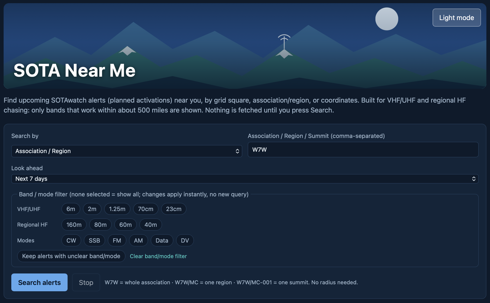
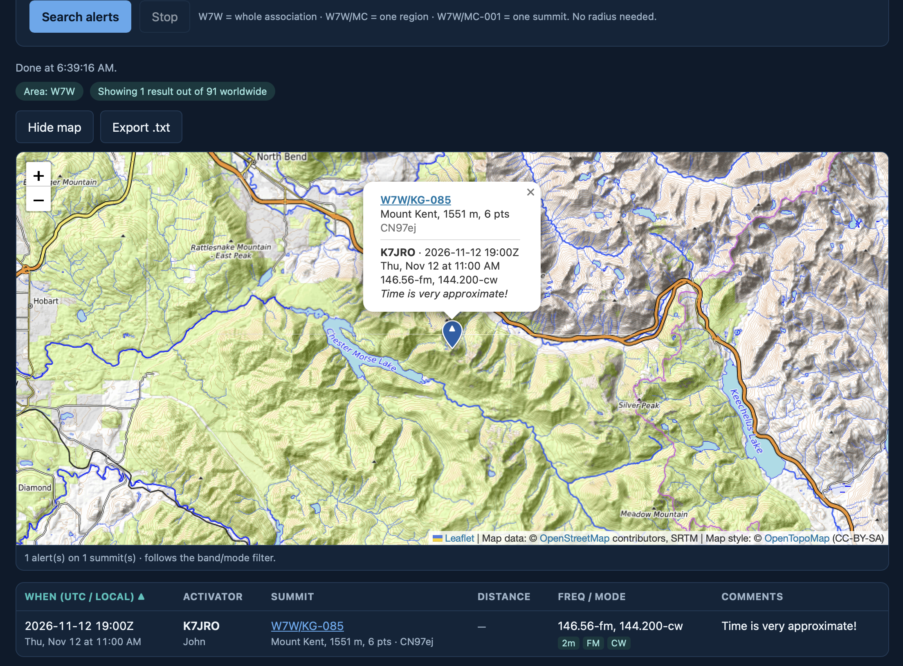

  

## Is anyone going to be on a summit near me?

As an amateur radio operator (Technician Class), I like to watch and occasionally chase [Summits on the Air (SOTA)](https://en.wikipedia.org/wiki/Summits_On_The_Air) from home, and right now my station is limited to VHF/UHF. That means the activations I can actually hear and work are currently the ones within line of sight, or close to it. A summit 250-500 miles away or more might as well be on the moon. So my main question currently is: *Is anyone going to be on a summit near me?*

Summit Activators post alerts ahead of time to say where and when they plan to be on the air. Those alerts are gold for a chaser, espcially those with HF privileges and equipment. But if you're an operator like me, the alerts are usefule only if you can quickly answer one thing: which of them are close enough for me to hear? 

I couldn't find a tool that answered that simply, so I built a very simple static web tool.

## The existing tools are good. They just weren't built for me.

Before writing and reviewing a single line of code, I researched what already exists. The SOTA community has excellent tools, and I use several of them. My favorite mobile app is genuinely useful in the field, and online tools have nice filtering capabilities. However, I've found that each one is built around a different job. What I am looking for was a combination of several things that currently requires me to use multiple tools to accomplish.

## What I wanted instead

I wrote down my requirements before I started, and kept them short on purpose:

1. **Search by where I am.** A grid square, a SOTA region, a single summit, or my actual coordinates.
2. **Map first.** Every search should land on a map, with the list underneath.
3. **Only bands relevant to nearby summits.** Show activations I have a realistic chance of working.
4. **Works anywhere.** One web page that runs the same on a laptop in the shack and a phone in the truck. Importantly: nothing to install.
5. **No credentials, keys or cookies.** No account to create, no API key to manage, nothing that tracks you.
6. **Simple and secure.** Small enough that I can read every line, and purposefully careful with data that comes from the internet.

## My solution: SOTA Near Me

[SOTA Near Me](https://marracci.github.io/sota-near-me/) is a single web page that searches SOTAwatch alerts and puts them on a topographic map. You pick how to search:

- **Grid square:** enter a Maidenhead locator like CN96 and a radius, or limit it to summits inside the square.
- **Association, region or summit:** W7W for a whole association, W7W/MC for one region, or W7W/MC-001 for a single summit.
- **Coordinates:** a latitude and longitude
- **My Location:** tap on "Use my location", accurate to 1km (on purpose)

Press Search, and the map opens with a pin on every summit that has an alert in your window. Tap a pin to see who's going, when they plan to activate, points, and on what frequency & mode. Distance and bearing from you are in the table below the map, and importantly, you can export the list to a plain text file for true offline use.

The key design choice is the band filter. The app only offers band queries that reliably work within about 500 miles or less: 6m, 2m, 1.25m, 70cm and 23cm, plus 160, 80, 60 and 40 meters on HF. An activator heading out with only a 20m antenna won't show up. One who lists both 20m and 2m will, because I might work them on 2m. Nothing disappears silently: the app tells you how many alerts it left out.

## Simple on purpose

[SOTA Near Me](https://marracci.github.io/sota-near-me/) is plain HTML, CSS and JavaScript, hosted for free on GitHub Pages. There's no server of mine in the middle, no build step, and no framework. You can clone the repository and open the page straight from your computer.

That simplicity also made it easier to keep it safe and private:

- **Nothing happens until you ask.** The app doesn't contact anything until you press Search.
- **No accounts, keys or cookies.** It talks only to the public SOTA data services and the map tile servers, and sends no login or cookie to either.
- **Your location stays with you.** "Use my location" only runs when you tap it, and it's rounded to about a kilometer before it's shown or saved in your browser.
- **Locked down by default.** A strict content security policy means the page can only run its own code and only connect to the handful of services it needs.
- **Internet data is treated as untrusted.** Alert text is always displayed as plain text, never as code, so a malformed or malicious alert can't do anything to your browser.

The map library is bundled with the page instead of loaded from a third-party CDN, so there's one less outside dependency to trust.

## What's next

I'm working toward my General license, and that's part of why the regional HF bands are already in the app. Once I can expand to General privileges on HF, the circle of summits I can reach gets a lot bigger, and [SOTA Near Me](https://marracci.github.io/sota-near-me/) will probably grow with me, or maybe just be deprecated.

If you're a VHF/UHF chaser, or anyone who mostly cares about what's happening nearby, give it a try at [marracci.github.io/sota-near-me](https://marracci.github.io/sota-near-me/). It's open source under the MIT license, and suggestions or bug reports are welcome on GitHub.

See you on the air, hopefully from a summit not too far away.

73 de KD7MTN

-----

Back to [Essays and Notes](/blog)
